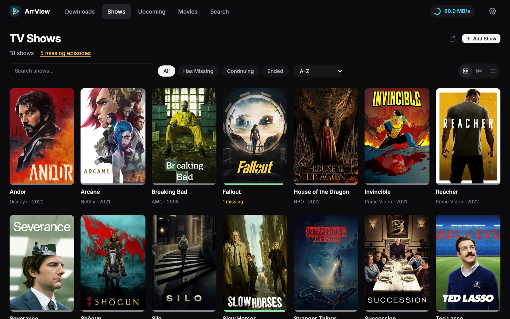
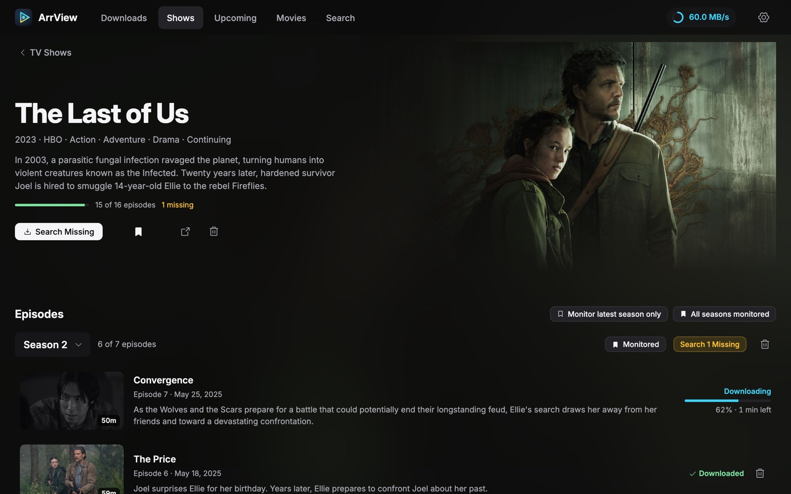
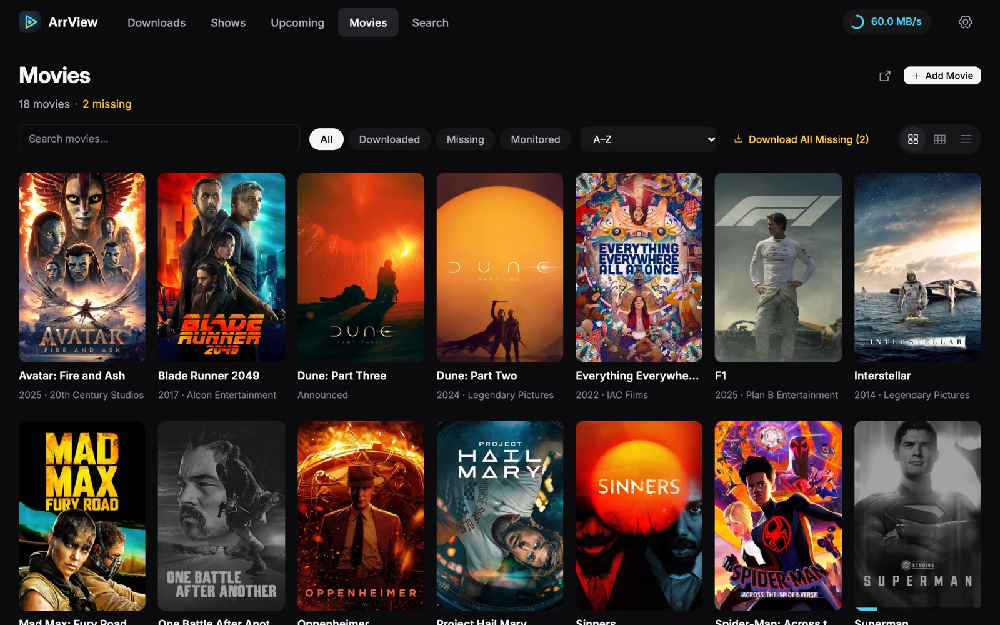
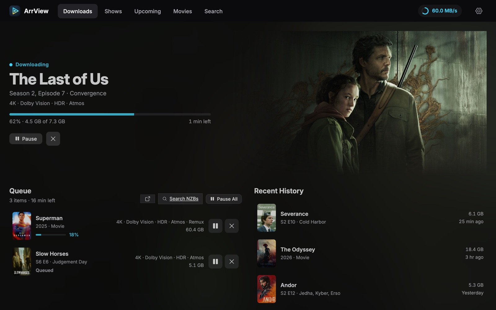
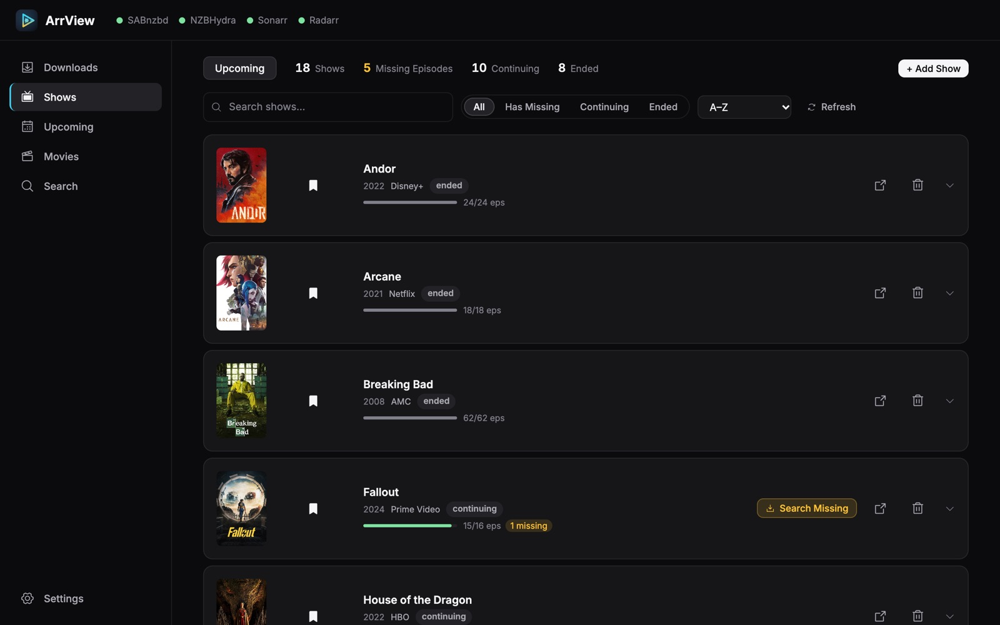
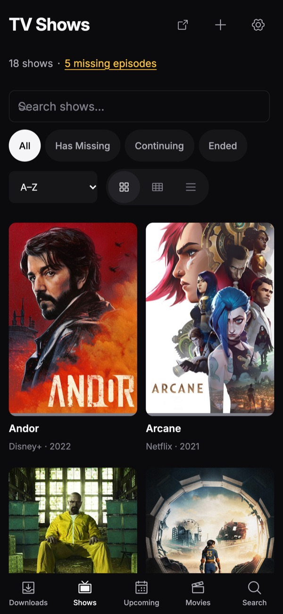
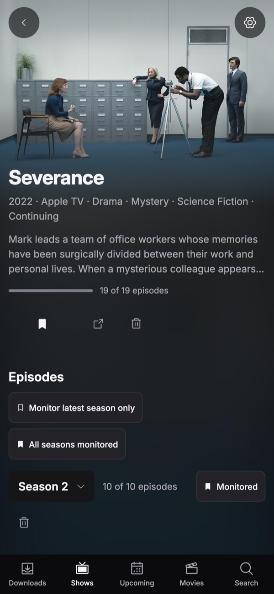
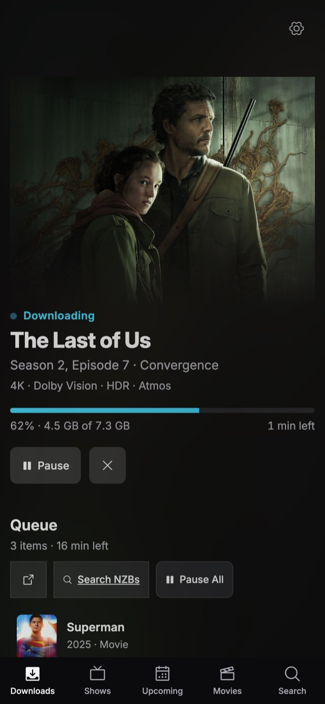

<p align="center">
  
</p>

<h1 align="center">ArrView</h1>

<p align="center">
  A self-hosted dashboard for Sonarr, Radarr, SABnzbd and NZBHydra.<br>
  Your shows, movies and downloads in one place, on any screen.
</p>

<p align="center">
  
</p>

ArrView runs as one small Docker container beside the apps you already use. It shows your TV shows and movies with
their artwork, what is downloading right now and what is coming up, and lets you search, monitor and download without
opening each app in turn. It is also the server for the
[ArrView app for iPhone and iPad](https://apps.apple.com/app/arrview/id6780331546).

- **TV shows and movies:** posters, a page for every show and movie, seasons and episodes, monitoring, searches and
  release lists.
- **Downloads:** the SABnzbd queue with live progress and artwork, pause, resume and delete, and recent history.
- **Upcoming:** episodes and movie releases for the next two weeks.
- **Search:** search NZBHydra (or a Newznab indexer) and send a result to SABnzbd.
- **Any screen:** desktop, tablet, phone and foldable, and it can be added to your Home Screen as an app.
- **Yours:** it runs on your own network, with no account and no tracking, and an optional password.

## Contents

- [What's new in 2.0](#whats-new-in-20)
- [Screenshots](#screenshots)
- [Quick start](#quick-start)
- [First run](#first-run)
- [Configuration reference](#configuration-reference)
- [Updating](#updating)
- [Features](#features)
- [Where ArrView keeps its data](#where-arrview-keeps-its-data)
- [Configure services from Docker (optional)](#configure-services-from-docker-optional)
- [Password login (optional)](#password-login-optional)
- [Webhooks: instant updates (optional)](#webhooks-instant-updates-optional)
- [The iPhone and iPad app, and auto-discovery](#the-iphone-and-ipad-app-and-auto-discovery)
- [HTTPS, remote access and the Home Screen app](#https-remote-access-and-the-home-screen-app)
- [Troubleshooting](#troubleshooting)
- [For developers](#for-developers)
- [Credits](#credits)

---

## What's new in 2.0

2.0 is the first release since 1.05, and nearly everything is new:

- **A new look.** The Modern layout puts the artwork first, with a page for every show and movie, poster, table and
  list views, and search, filters and sorting on every library page. The original layout is still there: choose
  **Classic** in **Settings → Layout**.
- **Show pages:** seasons and episodes with stills, a search for what is missing, the release list for an episode,
  and deleting episode files. Monitoring by season, for every season at once, or for the latest season only.
- **Movie pages:** file details, release search, monitoring, and deleting a movie's files with or without removing
  it from Radarr.
- **Downloads** shows each item's artwork from Sonarr or Radarr; **Upcoming** is a calendar of episodes and digital
  and physical movie releases; **Search** sends NZBHydra results to SABnzbd; and shows and movies can be added from
  ArrView.
- **Open the apps behind ArrView:** a link on each page opens Sonarr, Radarr, SABnzbd or NZBHydra in a new tab.
- **Phones, tablets and foldables,** and an installable Home Screen app.
- **An optional password login,** with keys for other apps and scripts.
- **Webhooks in Settings:** the webhook addresses, the last event received, and a button that adds ArrView's webhook
  to Sonarr and Radarr for you.
- **Configure services from Docker** variables or secret files instead of the Settings page.
- **Settings checks more:** the Test button says when a port is missing, when an API key is refused, and when an
  address leads to the wrong app.
- **A built-in Docker health check:** `docker ps` shows whether ArrView is `healthy`.

**Upgrading from 1.05.** Your settings carry over: both versions keep them in `config.json` in the container's `/data`
folder, which the 1.05 Compose file mapped to `./data`. Pull the new image and recreate the container
([Updating](#updating)). If you ran 1.05 with nothing mounted at `/data`, its settings were inside the old container,
so enter them again in Settings. The iPhone and iPad app works with 2.0 as it did with 1.05 while the password login
is off, which it is unless you turn it on.

## Screenshots

<table>
  <tr>
    <td width="50%"></td>
    <td width="50%"></td>
  </tr>
  <tr>
    <td>A show page, with its seasons, episodes and monitoring</td>
    <td>Movies</td>
  </tr>
  <tr>
    <td></td>
    <td></td>
  </tr>
  <tr>
    <td>Downloads, with artwork from Sonarr and Radarr</td>
    <td>The Classic layout, for those who prefer the original</td>
  </tr>
</table>

<p align="center">
  &nbsp;
  &nbsp;
  
</p>

## Quick start

ArrView needs Docker, and the addresses and API keys of the apps you use: any of Sonarr, Radarr, SABnzbd and NZBHydra.
The image is `ghcr.io/tvstuffs/arrview` for `linux/amd64` and `linux/arm64`.

### Docker Compose (recommended)

Save this as `docker-compose.yml` in a folder of its own:

```yaml
services:
  arrview:
    image: ghcr.io/tvstuffs/arrview:latest
    container_name: arrview
    restart: unless-stopped
    network_mode: host      # lets the iPhone app find ArrView on your network (Linux only)
    hostname: arrview       # the name it advertises: arrview.local
    volumes:
      - ./data:/data        # where ArrView keeps its settings
```

Then start it from that folder:

```bash
docker compose up -d
```

and open `http://<your-server>:7777`. The [`docker-compose.yml`](docker-compose.yml) in this repository is the same
file with every option written out as a comment.

### docker run

```bash
docker run -d --name arrview --restart unless-stopped \
  --network host --hostname arrview \
  -v "$PWD/arrview-data:/data" \
  ghcr.io/tvstuffs/arrview:latest
```

**Without host networking** (Docker Desktop on a Mac or Windows PC, or when port 7777 is taken), publish the port
instead: replace `--network host` with `-p 7777:7777` (in Compose, `ports: ["7777:7777"]` instead of
`network_mode: host`). Everything works except auto-discovery in the iPhone app, where you type the address instead.
To use another port with host networking, set `PORT` (see the [reference](#configuration-reference)).

## First run

1. **Open ArrView.** A new install first asks whether to protect it with a password. Set one, or continue without;
   you can change this later in **Settings → Security** (see [Password login](#password-login-optional)).
2. **Add your apps** in **Settings → Services**. For each one, enter its address and API key, press **Test**, then
   **Save**. Only the apps you add get a page: Downloads needs SABnzbd, TV Shows needs Sonarr, Movies needs Radarr,
   Search needs NZBHydra, and Upcoming needs Sonarr or Radarr.
3. **Optional:** set up [webhooks](#webhooks-instant-updates-optional) for instant updates, choose the Modern or
   Classic layout in **Settings → Layout**, and see **Settings → Add to Home Screen**.

**Addresses.** An `http://` address must name its port, as in `http://192.0.2.10:8989`: SABnzbd usually uses 8080,
Sonarr 8989, Radarr 7878 and NZBHydra 5076, or whatever port you mapped. An `https://` address needs no port when the
host name already leads to the app, as with a reverse proxy; a port you do type is used as written. ArrView adds no
port to what you type in Settings. Addresses saved before this rule keep working. (Here and below, `192.0.2.10`
stands for the address of the machine that runs the app.)

ArrView connects to the apps from inside its container. With host networking, `localhost` means the host itself; with
a published port, `localhost` is the container, so use the host's IP address.

**Finding your API keys:**

| App | Where |
|---------|----------|
| **SABnzbd** | Config → General → Security → API Key |
| **NZBHydra** | Config → Main → API key |
| **Sonarr** | Settings → General → Security → API Key |
| **Radarr** | Settings → General → Security → API Key |

**What Test checks.** Test says Connected, with the app's version, only when the app itself answers and accepts the
key:

- A key the app refuses fails the Test (for SABnzbd: "SABnzbd refused this API key"), and the status in Settings
  shows the app as not connected. SABnzbd and NZBHydra are asked something that needs the key, because both
  answer some requests whatever key is sent.
- Sonarr's address and key in the Radarr row (or the other way round) tests as "That address is Sonarr, not Radarr".
  The two share one API, so without this check the pages of that row would fail later. An app too old to name itself
  (Sonarr 3) is accepted.
- A web page, or another app, at the address tests as "That address answered, but not like SABnzbd" (or the app you
  chose).
- A plain Newznab indexer works in the NZBHydra row: enter its address without `/api`.

Save asks nothing of the apps, so you can save a row while its app is stopped.

## Configuration reference

Everything can be set in the web app's Settings. The environment variables below are optional: use them for
repeatable deployments, or to keep keys and passwords in secret files.

### Environment variables

`<SVC>` stands for `SONARR`, `RADARR`, `SABNZBD` or `NZBHYDRA`.

| Variable | Default | What it does | Example |
|---|---|---|---|
| `PORT` | `7777` | The port ArrView listens on. With host networking it is the port on the host. | `PORT=8080` |
| `CONFIG_DIR` | `/data` | The folder for `config.json` and `auth.json`. The image sets it; mount a folder or volume at `/data` rather than changing it. | `CONFIG_DIR=/data` |
| `ARRVIEW_HOST` | none | One address for all the apps whose key is set by a variable. Each app then uses its default port (8080, 8989, 7878, 5076). A host name or IP address, optionally with `http://` or `https://`; no port or path. | `ARRVIEW_HOST=192.0.2.10` |
| `ARRVIEW_<SVC>_URL` | none | One app's own address, in place of `ARRVIEW_HOST` for that app. A path is allowed. | `ARRVIEW_SONARR_URL=http://192.0.2.10:8989/sonarr` |
| `ARRVIEW_<SVC>_API_KEY` | none | That app's API key. It shows in `docker inspect`; the `_FILE` form below does not. | `ARRVIEW_RADARR_API_KEY=<your-radarr-api-key>` |
| `ARRVIEW_<SVC>_API_KEY_FILE` | none | A file inside the container that holds the key, instead of the key itself. | `ARRVIEW_SABNZBD_API_KEY_FILE=/run/secrets/sabnzbd_api_key` |
| `ARRVIEW_PASSWORD` | none | Turns the password login on with this password. | `ARRVIEW_PASSWORD=<your-password>` |
| `ARRVIEW_PASSWORD_FILE` | none | A file inside the container that holds the password. Set this or `ARRVIEW_PASSWORD`, not both. | `ARRVIEW_PASSWORD_FILE=/run/secrets/arrview_password` |
| `ARRVIEW_AUTH` | none | `off` turns the login off, whatever else is set: the recovery switch. | `ARRVIEW_AUTH=off` |
| `ARRVIEW_TRUSTED_PROXIES` | none | The reverse proxies whose `X-Forwarded-For` and `X-Forwarded-Proto` ArrView believes: addresses or ranges, separated by commas. | `ARRVIEW_TRUSTED_PROXIES=192.0.2.20, 198.51.100.0/24` |
| `ADVERTISE_HOST` | the container's host name | The host name the iPhone app discovers; `.local` is added. | `ADVERTISE_HOST=arrview` |
| `ADVERTISE_IP` | the first LAN IPv4 address found | The IPv4 address the iPhone app discovers. | `ADVERTISE_IP=192.0.2.10` |
| `ARRVIEW_TAG` | `latest` | Read by this repository's `docker-compose.yml` only: which image tag to run. | `ARRVIEW_TAG=v2.0` |

An app counts as set from Docker only when it has both a key and an address (from `ARRVIEW_HOST` or its own `_URL`).
It is then read-only in Settings. The rules and edge cases are in
[Configure services from Docker](#configure-services-from-docker-optional) and
[Password login](#password-login-optional); `ADVERTISE_HOST` and `ADVERTISE_IP` are described under
[auto-discovery](#the-iphone-and-ipad-app-and-auto-discovery).

### Container settings

| Setting | Recommended | Notes |
|---|---|---|
| Image | `ghcr.io/tvstuffs/arrview:latest` | Tags: `latest` (the current release), `v2.0` (this release, never moves), `dev` (development builds). See [Updating](#updating). |
| Network | `--network host` (`network_mode: host`) | Needed for auto-discovery in the iPhone app. Linux only. Otherwise publish the port: `-p 7777:7777`. |
| Host name | `--hostname arrview` (`hostname: arrview`) | The name the iPhone app shows and finds: `arrview.local`. |
| Data | `-v ./data:/data` | A folder or a named volume keeps your settings across updates. See [Where ArrView keeps its data](#where-arrview-keeps-its-data). |
| Restart policy | `unless-stopped` | |
| Memory | 256 MiB or more with the password login | Each password check needs about 128 MiB for a moment. |
| Health check | built in | `/api/health` every 30 seconds; `docker ps` shows `healthy`. |
| Secrets | bind-mount files read-only | For the `_FILE` variables, for example `-v ./secrets/arrview_password:/run/secrets/arrview_password:ro`. |

### A complete example

A Compose file with every option in use. Keep only the lines you need:

```yaml
services:
  arrview:
    image: ghcr.io/tvstuffs/arrview:latest
    container_name: arrview
    restart: unless-stopped
    network_mode: host
    hostname: arrview
    environment:
      PORT: 7777
      # The apps, from Docker instead of Settings: one address for all, keys from secret files.
      ARRVIEW_HOST: 192.0.2.10
      ARRVIEW_SONARR_API_KEY_FILE: /run/secrets/sonarr_api_key
      ARRVIEW_RADARR_API_KEY_FILE: /run/secrets/radarr_api_key
      ARRVIEW_SABNZBD_API_KEY_FILE: /run/secrets/sabnzbd_api_key
      ARRVIEW_NZBHYDRA_API_KEY_FILE: /run/secrets/nzbhydra_api_key
      # An app whose address differs from ARRVIEW_HOST and its default port:
      ARRVIEW_SABNZBD_URL: http://192.0.2.11:8085
      # The password login:
      ARRVIEW_PASSWORD_FILE: /run/secrets/arrview_password
      # A reverse proxy in front of ArrView:
      ARRVIEW_TRUSTED_PROXIES: 192.0.2.20
      # What the iPhone app discovers:
      ADVERTISE_HOST: arrview
      ADVERTISE_IP: 192.0.2.10
    volumes:
      - ./data:/data
      - ./secrets/sonarr_api_key:/run/secrets/sonarr_api_key:ro
      - ./secrets/radarr_api_key:/run/secrets/radarr_api_key:ro
      - ./secrets/sabnzbd_api_key:/run/secrets/sabnzbd_api_key:ro
      - ./secrets/nzbhydra_api_key:/run/secrets/nzbhydra_api_key:ro
      - ./secrets/arrview_password:/run/secrets/arrview_password:ro
```

The same with `docker run`, with the keys given directly (they then show in `docker inspect`; the secret files above
do not):

```bash
docker run -d --name arrview --restart unless-stopped \
  --network host --hostname arrview \
  -e ARRVIEW_HOST=192.0.2.10 \
  -e ARRVIEW_SONARR_API_KEY=<your-sonarr-api-key> \
  -e ARRVIEW_RADARR_API_KEY=<your-radarr-api-key> \
  -e ARRVIEW_SABNZBD_API_KEY=<your-sabnzbd-api-key> \
  -e ARRVIEW_NZBHYDRA_API_KEY=<your-nzbhydra-api-key> \
  -v "$PWD/arrview-data:/data" \
  ghcr.io/tvstuffs/arrview:latest
```

## Updating

With Compose, from the folder that holds `docker-compose.yml`:

```bash
docker compose pull
docker compose up -d
```

With `docker run`: `docker pull ghcr.io/tvstuffs/arrview:latest`, then `docker rm -f arrview` and run the same
`docker run` command again. Your settings stay as long as `/data` is a folder or a named volume.

A new image does not update a running container by itself. The tags:

| Tag | What it is |
|---|---|
| `latest` | The current release. |
| `v2.0` | This release. It never moves, so it is the one to pin. |
| `dev` | Development builds, which change often and are not supported. |

The `docker-compose.yml` in this repository reads the tag from `ARRVIEW_TAG`, so `ARRVIEW_TAG=v2.0` in a `.env` file
beside it pins this release. To run a development build next to a release, use a second Compose project with its own
container name, port and data folder, never the same data folder.

## Features

ArrView has two layouts: **Modern**, the default, and **Classic**, the original. Switch in **Settings → Layout**; the
choice is kept in that browser.

### Downloads (SABnzbd)

- The SABnzbd queue with live progress, speed and time left, and the artwork of the show or movie from Sonarr or
  Radarr.
- Pause, resume and delete single items, or the whole queue.
- Recent history, naming each finished episode as the queue does ("S2 E6 · Cold Harbor"), with more on request.
- While something downloads, the speed shows in the header of every page.

### TV Shows (Sonarr)

- Every show as a poster, in a table or in a list, with a search box, the filters All, Has Missing, Continuing and
  Ended, and sorting by name, most missing or newest.
- A count of missing episodes for each show and for the library.
- A page for every show: its artwork, details and progress, and each season's episodes with their stills, air dates,
  descriptions and status, including what is downloading now.
- Searches: the whole show's missing episodes, a season or one episode. When every aired episode of a season is wanted, the season is
  searched with Sonarr's own season search, so a season pack can be taken; otherwise the wanted episodes are searched
  one by one. A season's **Search N Missing** counts the monitored aired episodes without a file, and says how many
  missing ones it leaves out as unmonitored.
- The release list of an episode, to pick a release yourself.
- **Monitor season**, on every season: it monitors the season and every episode in it, as Sonarr's own season
  bookmark does, and reads **Monitored** once the whole season is. A press then unmonitors it.
- **Monitor all seasons**, on a show with more than one season: one press monitors every season and every episode in
  them, and the show itself if it was not monitored, because Sonarr grabs nothing for an unmonitored show. The
  specials (season 0) are left as they are, as Sonarr's own "All Episodes" leaves them. It reads
  **All seasons monitored** once everything is; a press then unmonitors every season and leaves the show's own
  setting as it was.
- **Monitor latest season only**, on a continuing show with more than one season: it monitors the newest season and
  any season Sonarr lists after it, unmonitors the earlier seasons, leaves the specials alone, and turns the show on
  if it was off. The newest season is the newest one with episodes in Sonarr, so when the next season has been
  announced with an episode, that season counts. It reads **Latest season only** when that is the state.
- Delete an episode's or a season's files and unmonitor them, and remove a show from Sonarr, keeping or deleting its
  files. Each asks first.
- Add a show: search, then choose the quality profile and root folder.
- **Open in Sonarr** opens the show in Sonarr.

### Movies (Radarr)

- Every movie as a poster, in a table or in a list, with a search box, the filters All, Downloaded, Missing and
  Monitored, and sorting by name, newest, recently added or recently downloaded.
- A page for every movie: its artwork and details, the file's quality and size, monitoring, and the release list.
- **Download All Missing**, and a download button for each available movie without a file.
- **Delete and Unmonitor** keeps the movie in Radarr; **Delete and Remove from Radarr** removes it and its files.
  Each asks first.
- Add a movie: search, then choose the quality profile and root folder.
- **Open in Radarr** opens the movie in Radarr.

### Upcoming

Episodes and movie releases from yesterday to 14 days ahead, in your time zone. Movies are listed by their digital
and physical release dates; a cinema date alone is not listed. It needs Sonarr or Radarr.

### Search (NZBHydra)

Search NZBHydra, or a Newznab indexer saved in its place, and send a result to SABnzbd.

### Settings

Your apps with their status and the Test button, the layout, the password and app keys, webhooks, and how to add
ArrView to your Home Screen. The ArrView version is at the bottom.

### Phones, tablets and foldables

Below 640 pixels wide the pages are laid out for phones, with a tab bar at the bottom and Settings behind the gear.
Wider windows have the navigation along the top (Classic puts it in a sidebar on wide screens). Short windows, such as
a foldable's cover screen or a phone held sideways, get a compact header. Touch targets are at least 44 pixels. The
app is dark only.

Your view choices (the tab, searches, filters, sorting and views) are kept in that browser, per address. Media, keys
and settings are never stored there.

## Where ArrView keeps its data

ArrView saves everything in one folder: `/data` inside the container (the `CONFIG_DIR` variable, which the image sets).
Outside Docker (`npm start`) it is the folder that holds `server.js`, unless you set `CONFIG_DIR`. The folder holds two
files, and no media:

- `config.json`: the service addresses and API keys you saved in Settings, and a few other settings such as the ArrView
  address used for webhooks. The keys are stored as plain text (ArrView creates the file with mode `0600`), so keep the
  folder to yourself. Services you set with `ARRVIEW_*` variables are never written to it.
- `auth.json`: the password login. It holds a hash of the password (if one is set) and hashes of the sign-in
  sessions and app keys, never the secrets themselves (see [Password login](#password-login-optional)).

You choose where that folder lives when you create the container:

- **A folder on your disk.** Add `-v "$PWD/arrview-data:/data"` to `docker run` (in Compose, `- ./data:/data`). The data
  sits in that folder on the host. It survives removing and recreating the container and image updates, and you back
  it up by copying the folder.
- **A named Docker volume.** Add `-v arrview-volume:/data`. Docker keeps the data in a volume it manages
  (`docker volume ls`), and it also survives removing and recreating the container. Docker tells a name from a path by
  the slash: `arrview-volume` is a volume, `./data` and `/srv/arrview` are folders.
- **Nothing: a disposable volume.** Leave `-v` out. ArrView works straight away: the image declares `/data` as a volume,
  so Docker creates an anonymous one for the container. That volume belongs to that one container. When you remove the
  container and create a new one (an image update with `docker rm` and `docker run`, or Recreate in Portainer, for
  example), the new container starts empty: the first-run screen again, no saved services, and a password you set in
  Settings is gone, so the login is off. The old volume stays behind under a long hex name (`docker volume ls`;
  `docker volume prune` deletes it).

A disposable volume is fine for trying ArrView out. For an install you keep, use a folder or a named volume. If your
services and password come from `ARRVIEW_*` variables, a new container started with the same variables has them again;
what a disposable volume loses is the sign-in sessions, any app keys you made, and anything saved in Settings that is
not a variable.

To see where a running container keeps its data, run `docker inspect arrview` and read `Mounts`; for a Docker-managed
volume, `docker volume inspect <name>` prints the folder Docker keeps it in. Mount the whole folder, not `config.json`
alone (see [Configure services from Docker](#configure-services-from-docker-optional)).

ArrView itself never creates the data folder: if `CONFIG_DIR` points at something that is not a writable folder (a
changed `CONFIG_DIR` with nothing mounted there, say), it says so in its log at start-up.

## Configure services from Docker (optional)

Instead of typing service addresses and keys into the Settings page, you can supply them as container environment
variables. This is useful for repeatable deployments. Without any `ARRVIEW_*` variables you configure services in
Settings, and the masked keys, request validation, key rule and atomic saves described below apply either way.

| Variable | Meaning |
|---|---|
| `ARRVIEW_HOST` | One address for all services, for example `localhost` or `192.0.2.10`. A host name (letters, digits, dots and hyphens; no underscores), IPv4 address or bracketed IPv6 address, optionally prefixed with `http://` or `https://`. No port, path, query, fragment or credentials. Each service uses its default port (SABnzbd 8080, Sonarr 8989, Radarr 7878, NZBHydra 5076). |
| `ARRVIEW_<SVC>_API_KEY` | API key, where `<SVC>` is `SONARR`, `RADARR`, `SABNZBD` or `NZBHYDRA`, for example `<your-sonarr-api-key>`. Surrounding whitespace and newlines are trimmed. |
| `ARRVIEW_<SVC>_API_KEY_FILE` | Path **inside the container** to a file containing the key, for example `/run/secrets/sonarr_api_key`, bind-mounted from `./secrets/sonarr_api_key` on the host (a relative path resolves from the container's `/app` directory). Read once at startup and trimmed. Set this or the plain variable, not both. |
| `ARRVIEW_<SVC>_URL` | Optional per-service address that replaces `ARRVIEW_HOST` for that service, for example `http://192.0.2.10:8989/sonarr`. Without a scheme `http://` is added. The default port is added only when the override has neither a scheme nor an explicit port. |

Rules:

- **A service is "env-managed" only when it has both a key and an address.**
  `ARRVIEW_HOST` never configures a service that has no env key. Env-managed
  services are applied on top of `config.json` on every read, are never written
  to it, and are read-only in Settings. To change them, edit the compose file or
  `.env` and recreate the container with `docker compose up -d`; after changing
  the contents of a secret file, restart it (`docker compose restart arrview`),
  because `up -d` may not notice a changed file. No image rebuild is needed.
- A half-configured service (a key with no address, an address with no key, or
  an invalid value) logs a `[config]` warning at startup, ignores all its env
  values and stays editable in Settings. The server still starts.
- An invalid `ARRVIEW_HOST` only affects services that rely on it; a service
  with a valid `ARRVIEW_<SVC>_URL` override and a key stays env-managed.
- Service URLs must not contain `?` or `#` (query strings and fragments are
  rejected everywhere, including Settings). A base path such as `/sonarr` is fine.
- The default port is added only to an override that has neither a scheme nor
  an explicit port (for example `ARRVIEW_SONARR_URL=192.0.2.10`).
  The Settings rule that an `http://` address must name its port is for what
  you type there; these variables keep adding each app's default port as
  described here.
- Mount the whole data directory (`./data:/data`), not `config.json` as a
  single-file bind mount: saves write a temporary file and rename it over
  `config.json`, which fails on a single-file mount.
- Atomic saves have these effects: the first `config.json` that ArrView creates
  is mode `0600` and owned by the user running the server (root in the
  container); an existing `config.json` keeps its mode but is owned by that user
  after the first save; a single-file bind mount of `config.json` fails, so
  mount the directory; a symlinked `config.json` is replaced by a regular file;
  and the data directory must be writable (on a read-only mount every save
  fails with a 500 "Could not save settings").
- API keys (typed in Settings or set in the environment) are trimmed and must
  contain at least one ASCII letter or number (`A`–`Z`, `a`–`z`, `0`–`9`). Typed
  keys are also limited to 256 characters with no control characters. A key such
  as `----` or only spaces is rejected: Settings refuses to save it, the server
  answers 400, and an environment key like that is logged by variable name and ignored.
- Environment values are read once at startup. Logs name variables but never
  print keys or secret file contents.
- With host networking (`network_mode: host`), containers share the host's
  network: use `localhost` or the host's address, not compose service names.
- Plain `ARRVIEW_<SVC>_API_KEY` values are visible in `docker inspect` and in any
  compose file you share or commit. Prefer `_FILE` secrets on shared hosts, and
  keep `.env` and `secrets/` out of git.

Settings and `GET /api/config` return API keys masked (`••••` plus the last four characters; keys of eight characters
or fewer show only `••••`). A masked key sent back is reused only if the address is unchanged; if you change a service
address you must re-enter its key. How scripts can read and save the configuration is in [docs/API.md](docs/API.md).

## Password login (optional)

ArrView can ask for a password. It is **off by default**: with no password set
nothing changes anywhere.

> **The ArrView iPhone and iPad app cannot sign in yet.** Turning the login on makes
> it fail (cleanly, with a 401) until an app update adds it. Webhooks from
> Sonarr and Radarr keep working. Do not turn the login on if you rely on the
> app.

**What it protects.** With a password set, one gate in front of every `/api`
route answers `401` to anyone who is not signed in. Reads need sign-in too. What
stays open: the app shell (so the Sign in screen can load), `GET /api/health`,
`GET /api/arrview/identify`, `GET /api/auth/status`, the sign-in routes
(`/api/auth/login`, `/logout`, `/token`) and the two webhook receivers
(`POST /api/webhooks/sonarr` and `/radarr`). `GET /api/webhooks/last` is protected.
Nothing else is public. `identify` reports `auth: true` and the `auth` capability.

**Turn it on in Settings.** Open **Settings → Security → Set a password** (8 to
256 characters; composed and decomposed accents count the same, and a password of
only spaces is refused). That browser is signed in at once and stays signed in for
30 days of use. While the login is off, anyone who can reach Settings can set the
first password.

**First run on a new install.** When the data folder has neither `config.json` nor
`auth.json`, no Docker password is set and `ARRVIEW_AUTH` is not `off`, the web app
opens on a setup screen before anything else: protect ArrView with a password, or
continue without one. It says plainly that without a password anyone who can reach
the address can use ArrView, including deleting files. Setting the password signs
that browser in. Continuing without one writes `auth.json` with no password, so the
screen never comes back; Settings can set a password later. Installs that have a
`config.json` never see it. An install that keeps every service in Docker variables
and has no `config.json` shows it once after upgrading; Continue without a password
dismisses it for good. **On a brand-new install that is
reachable from outside, the first visitor could set the password.** The Docker
password, `ARRVIEW_AUTH=off` or removing `auth.json` recover it (see Recovery).
The screen makes nothing else public: `GET /api/auth/status` only reports whether
setup is pending.

**Or from Docker.** Set one of these (never both):

| Variable | Value |
|---|---|
| `ARRVIEW_PASSWORD` | `<your-password>`. Visible in `docker inspect`; prefer the file form. Never trimmed. |
| `ARRVIEW_PASSWORD_FILE` | `/run/secrets/arrview_password`, bind-mounted from `./secrets/arrview_password`. One trailing newline is removed; nothing else is trimmed. |
| `ARRVIEW_AUTH` | `off` turns the login off whatever else is set. Any other value is ignored (logged without printing it). |
| `ARRVIEW_TRUSTED_PROXIES` | For example `192.0.2.10, 198.51.100.0/24, 2001:db8::/32`. See below. |

- A Docker password wins: the password is read-only in Settings, a password
  saved in Settings no longer works, and changing it means editing the compose
  file or secret file and recreating the container with `docker compose up -d`.
  No image rebuild is needed.
- A changed value signs everyone out and removes every app key. An unchanged
  value across restarts keeps sessions and keys.
- **Memory.** Each password check (sign-in, and checking a Docker password at
  start-up) needs about 128 MiB of memory for a moment. In a container with a tight
  memory limit nobody can sign in, and a Docker password then fails closed (the
  login stays on, nobody gets in). Give the container at least 256 MiB.
- A Docker password setting that is set but invalid (both variables, empty, an
  unreadable file, the wrong length) keeps the login **on** and lets nobody in,
  with a log line naming the variable (never its value). Fix it, or set
  `ARRVIEW_AUTH=off`. This is deliberate: a mistyped secret path must not open
  the server.
- **Removing the Docker password turns the login off.** If both
  `ARRVIEW_PASSWORD` and `ARRVIEW_PASSWORD_FILE` are unset at start and `auth.json`
  holds a password that came from Docker, ArrView deletes that password with every
  session and key, so the login is off, and logs one line saying why. If that
  deletion cannot be written, the login stays on and nobody can sign in. A
  password set in Settings is not affected.
  **If the Docker password variable is accidentally missing when you recreate the
  container (a typo, a lost `.env` file, a secret that did not mount), the login
  turns off and ArrView is open to anyone who can reach it.**
- **Moving from a Docker password to a Settings password.** While a Docker
  password is set, the password controls in Settings are read-only, so you cannot
  set a Settings password first. To switch: restrict access to ArrView outside
  ArrView (firewall, reverse proxy rule or closed port), recreate the container
  without `ARRVIEW_PASSWORD` and `ARRVIEW_PASSWORD_FILE` (the login is off while
  you do this), set the password in Settings, check that the login screen now
  appears, and only then restore access. Or keep managing the password through
  Docker.

**The session cookie.** The browser holds `arrview_session`: a random token,
`HttpOnly`, `SameSite=Lax`, valid for 30 days and renewed as you use ArrView (the
server extends it at most once a day per session). `auth.json` keeps only a
SHA-256 digest of each token, so nothing in the file can be used to sign in. It
carries the `Secure` flag only when the request arrived over HTTPS, directly or
through a trusted proxy. Sessions live on the server (at most 50; the oldest is
dropped): **Sign out** ends only that browser's session, so a copied cookie stops
working at once; **Sign out everywhere** and any password change end every
session and remove every app key. Removing a session or a key also ends its open
event stream. Browsers send cookies to every port on the same host name, so a
second ArrView on another port of the same host name shares and overwrites the
cookie, and other apps on that host name (Sonarr, Radarr) receive it. Requests
from a signed-in browser that change something must send
`X-Requested-With: ArrView`; the web app does this.

**Trusted proxies.** `ARRVIEW_TRUSTED_PROXIES` lists the reverse proxies whose
`X-Forwarded-For` and `X-Forwarded-Proto` ArrView believes: comma-separated IPv4 or
IPv6 addresses or ranges. Unset, nothing is trusted and those headers are ignored.
Any invalid entry (a `/0` range counts) makes the whole list trust nothing, with a
log line. IPv6 entries in the old dotted-tail form (`::192.0.2.1`,
`::192.0.2.1/96`) are refused the same way; write them as `192.0.2.1`. The address
decides the sign-in limit, and `X-Forwarded-Proto: https` from a listed proxy gets
the cookie its `Secure` flag.

> **Behind a reverse proxy, set `ARRVIEW_TRUSTED_PROXIES`.** Without it every
> client reaches ArrView from the proxy's address and shares one sign-in limit, so
> ten wrong passwords from anyone lock everyone out for 15 minutes.

**App keys (apps and scripts).** Make one key for each app or script, so you can
remove one without touching the others. In **Settings → Security → Keys for apps
and scripts** a signed-in browser can make a key (it asks for your current password,
and a wrong one counts toward the sign-in limit; the name is optional, up to 40
characters, "App key" if left empty), see the list (name, created, last used) and
remove one key or all of them. A new key appears once, in a read-only field, with a
**Copy** button; **ArrView stores only a digest, so nothing can show it again.**
If you lose a key, remove it and make another. At most 50 keys. A script can make
one with the password:

```bash
curl -s -X POST -H "Content-Type: application/json" \
  -d '{"password":"<your-password>","name":"Backup script"}' http://arrview.example:7777/api/auth/token
# {"accessKey":"<your-access-key>","id":"<key-id>","name":"Backup script","created":1790000000}
curl -s -H "X-Api-Key: <your-access-key>" http://arrview.example:7777/api/config
```

Send the key as `X-Api-Key` or `Authorization: Bearer`. The "last used" date is
written at most once a day. Copy works in every browser, including Safari over
plain HTTP: if a browser refuses, the key stays selected so it can be copied by
hand.

**Wrong passwords.** Each address may fail 10 times in 15 minutes; then the
server answers `429` with `Retry-After` until the oldest failure ages out. A wrong
password takes at least half a second to answer. The limit is in memory and a
restart clears it. Every failure logs one line, which a fail2ban filter can use
(this regex is **unverified** here):

```
[auth] sign-in failed from <ip> route=login
failregex = \[auth\] sign-in failed from <HOST>
```

**Where it lives.** `auth.json` in the data directory (mode `0600`, written
atomically), never in `config.json`. It holds a scrypt hash of the password and
SHA-256 digests of the session tokens and app keys, and nothing that can be used
to sign in. It is read once at start; editing it by hand needs a restart. A file
from an earlier test build (version 1) keeps its password, drops the old secret and
key, and everyone signs in again. Rolling back to an older image (1.05, or a
development build up to 1.9A4) **opens the server**: those builds ignore the file
and have no login. Upgrading again finds the password intact.

**Recovery.** Lost the password? `ARRVIEW_AUTH=off` alone does not reset it: it
only switches the login off while the variable is set, and the saved password
comes back when you remove the variable. Use one of these two procedures. If
`auth.json` exists but cannot be read or is invalid, the login stays on, nobody
can sign in, and the log points here; either procedure fixes it.

*Replace the password with a Docker one:*

1. Remove `ARRVIEW_AUTH=off` from the container's environment if it is set.
   While it is set, any password variable is ignored.
2. Set exactly one of `ARRVIEW_PASSWORD` or `ARRVIEW_PASSWORD_FILE` to the new
   password (or the path of a file that holds it) and remove the other.
3. Recreate the container. Everyone is signed out and the new password applies.

*Reset to no password and set a new one in Settings:*

1. Stop the container.
2. Remove `auth.json` from the data directory.
3. Remove `ARRVIEW_AUTH=off`, `ARRVIEW_PASSWORD` and `ARRVIEW_PASSWORD_FILE`
   from the container's environment. If a Docker password is still set, the
   start-up recreates the file from it.
4. Start the container. The login is off until you act.
5. Open Settings and set a new password.

Not built yet: signing in from the iPhone and iPad app, reading without signing in
from the local network, identity headers from a proxy such as Tailscale Serve, and
a Host allow-list. Keep ArrView off the public internet until they exist.

## Webhooks: instant updates (optional)

Sonarr and Radarr can tell ArrView the moment something changes, so the web
dashboard and the iPhone app (when it connects through ArrView) refresh at once
instead of at the next timed refresh, which is up to a minute later. Without
webhooks everything still works, just a little later. The app's Connect Directly
mode never uses them.

**Settings → Webhooks** appears once Sonarr or Radarr is saved. It holds:

- **ArrView address for Sonarr and Radarr**: the address those two use to reach
  ArrView, such as `http://192.0.2.10:7777`. It has to work from where Sonarr and
  Radarr run, which can differ from the address in your browser: use the IP
  address of the machine that runs ArrView, not a name ending in `.local`
  (containers often cannot look those up). Leave it empty to use the address of
  the page you have open. Press **Save** to keep it.
- The two webhook URLs built from it, `<address>/api/webhooks/sonarr` and
  `<address>/api/webhooks/radarr`, each with a **Copy** button.
- **Status in Sonarr** and **Status in Radarr**, one for each of the two that
  is configured: whether the app already has ArrView's webhook (`Set up.` or
  `Not set up.`), with a **Set up** or a **Remove** button to change that from
  here.
- **Last event received**: for Sonarr and for Radarr, the last event that
  reached ArrView and how long ago, such as `Download (file import), 3 hours ago`,
  and separately the last test message. It refreshes every few seconds while
  Settings is open, so you can press Test in Sonarr and watch
  `Test message received less than a minute ago` appear. It lives in memory, so it
  starts empty (`No event since ArrView started 2 days ago`) whenever the container
  restarts, and it only shows that a message arrived, not who sent it.
- Step-by-step setup for each app and a troubleshooting list.

**Set up and Remove.** **Set up in Sonarr** (or **in Radarr**) shows what it
will add (a connection named `ArrView` with that app's webhook URL, method POST
and the six triggers of the table below) and adds it when you press **Add**.
The app sends ArrView a test message before it saves. If that test fails,
nothing is saved and the card shows the app's reason. If it passes, the app
saves the webhook and the card says whether ArrView itself received the
message: a login page or a redirect at that address can pass the app's test
too. Set up uses the saved address only: with none saved the status reads
`Save the ArrView address above first.`, and the button is disabled while the
field holds unsaved changes. **Remove from Sonarr** (or **from Radarr**) asks
first and deletes only ArrView's webhook; your other connections are not
changed.

ArrView's server does this itself, with the address and API key it holds for
the app, and the page is told the outcome and nothing else about the app's
connections. It never edits a connection that exists: a webhook of its own at
an address other than the saved one reads `Set up, but at a different address`
with that address, to fix in the app or to remove here and set up again. For a
row that holds the other app's address the status says so and offers no button
(see [First run](#first-run)).

**By hand.** With **Set up** there is nothing more to do in Sonarr or Radarr. To
add the same connection by hand instead, open **Settings → Connect** in Sonarr or
Radarr, select **+** and choose **Webhook**. ArrView recognises its webhook by the
URL, whatever the connection is called.

| Field | Value |
|---|---|
| Name | `ArrView` |
| Notification Triggers | Sonarr: On File Import, On File Upgrade, On Rename, On Series Add, On Series Delete, On Episode File Delete. Radarr: On File Import, On File Upgrade, On Rename, On Movie Added, On Movie Delete, On Movie File Delete. Older versions call the first two On Download and On Upgrade. Leave the others off: health and update events do not change what ArrView shows. |
| Webhook URL | The URL from Settings |
| Method | `POST` (ArrView only accepts POST) |
| Username, Password, Headers | Leave empty; ArrView does not use them |

Select **Test**, then **Save**. A green check on Test only means that something
at that address answered: a login page or a redirect also passes. The proof
that ArrView received it is `Test message received` under
**Last event received**, within a few seconds. Each real event shows there too,
adds a line such as `[Sonarr webhook] Download — series: Name` to ArrView's log
(`docker logs arrview`), and refreshes the pages that are open.

To check ArrView on its own, send an event by hand from any computer that can
reach it (no Sonarr or Radarr involved):

```bash
curl -X POST -H "Content-Type: application/json" \
  -d '{"eventType":"Download","series":{"title":"ArrView test"}}' \
  "http://<host>:7777/api/webhooks/sonarr"
```

If Test fails in Sonarr or Radarr, the address cannot be reached from where it
runs: use the machine's IP address, remember that `localhost` inside a container
is the container itself, and check the firewall. If ArrView sits behind an HTTPS
proxy whose certificate Sonarr or Radarr does not trust, use ArrView's plain
`http` address for the webhook. If Test passes but nothing updates, look under
**Last event received**: if `Test message received` did not appear, the test
reached something other than this ArrView (a login page, a redirect from a proxy,
or another server at that address); if it did, check the triggers.

ArrView does not check who calls a webhook, so anyone who can reach its address
can make it refresh. This stays true when the password login is on: the two
receivers, `POST /api/webhooks/sonarr` and `/radarr`, are the only data routes that
stay open, so Sonarr and Radarr keep working without edits. Keep ArrView off the
public internet unless something in front of it asks for a login. To limit what such
calls can do, a webhook refreshes the open pages at most once a second per app (events
that arrive closer together are merged into one refresh), and a malformed event is
refused.

## The iPhone and iPad app, and auto-discovery

[ArrView for iPhone and iPad](https://apps.apple.com/app/arrview/id6780331546) is free on the App Store. It can
connect through this server, or straight to your apps with **Connect Directly**. Through the server, it finds
ArrView on your network by itself, over Bonjour (mDNS), and refreshes at once when [webhooks](#webhooks-instant-updates-optional)
are set up. While the password login is on, the app cannot connect through the server yet.

> **Auto-discovery requires host networking.** The container advertises
> itself over Bonjour/mDNS so the app can find it on the network
> without typing an address. mDNS is **multicast**, which Docker's bridge
> network does **not** forward: publishing ports (`-p 7777:7777`) only forwards
> the unicast HTTP traffic, so the advertisement never leaves the container and
> discovery silently fails. Run with `--network host` (or `network_mode: host`
> in Compose) so the advertisement reaches the LAN. Notes:
> - Host networking is **Linux-only**; it does not broadcast to the LAN under
>   Docker Desktop for Mac/Windows (Docker runs in a VM there).
> - Ensure the host firewall allows UDP **5353** (mDNS).
> - Another mDNS responder on the host (Avahi, or a NAS's built-in discovery
>   service) may already own UDP **5353** without sharing it. ArrView then logs
>   one `Bonjour: bind EADDRINUSE 0.0.0.0:5353 — …` line, shows a notice on the
>   Settings page and keeps running, but auto-discovery is unavailable:
>   enter `http://<host>:7777` in the app by hand. To get discovery back, give
>   the container its own LAN address (a Docker macvlan or ipvlan network) or
>   turn the host's responder off, then restart the container.
> - If you can't use host networking, the app still works: enter
>   `http://<host>:7777` in the app by hand, or choose **Connect Directly**.

**Choosing what is advertised.** Two environment variables set what the Bonjour
advertisement says. ArrView reads them once, at start-up.

- `ADVERTISE_HOST` is the host name to advertise. ArrView adds `.local` to it
  and does not double a `.local` you already typed, so `arrview` and
  `arrview.local` both advertise `arrview.local`. If it is not set, ArrView
  uses the container's host name as Node.js reports it (`os.hostname()`): the
  container ID in a bridged container, the Docker host's own name under host
  networking, or the name set with `hostname:` in Compose (`--hostname` in
  `docker run`). The Compose file in this repository sets `hostname: arrview`.
- `ADVERTISE_IP` is the single IPv4 address to advertise, for example
  `192.0.2.10`. If it is not set, ArrView uses the first non-internal IPv4
  address it finds on an interface whose name does not start with `docker`,
  `br-`, `veth`, `virbr`, `cni`, `flannel`, `tailscale`, `zt`, `wg` or `lo`
  (letter case is ignored). Set it when that is not the address the app
  should use. Use an address of this host; ArrView does not check the value, and
  an address that is not one of the host's own is untested.
- To see what was chosen, read the start-up log line that begins
  `Bonjour: advertising`. It names the host name and address in use
  (`all interfaces` stands in for the address when no interface qualified).
  It reports the choice, not whether the announcement reached the network.

## HTTPS, remote access and the Home Screen app

**Add ArrView to your Home Screen.** **Settings → Add to Home Screen** has the steps for your device. On supported
Chromium browsers an **Install ArrView** button appears when the browser makes installation available; its absence is
normal on Safari, after dismissal, or before the browser's installation criteria are met.

- **iPhone and iPad:** in Safari, Share → Add to Home Screen → Add. Keep "Open as Web App" on if offered. Plain HTTP
  on your network works for the Home Screen app; HTTPS is needed for the offline screen.
- **Android:** in Chrome over HTTPS, menu → Install app (or Add to Home screen) → Install. Over plain HTTP, Add to
  Home screen creates a browser shortcut, not a standalone app.
- **Desktop:** use the browser's Install app control where it has one.

Over HTTPS (or on `localhost`) ArrView also shows "Can't reach your ArrView server" with a **Try again** button when
the server is offline, instead of a browser error. It never stores your library, queues, settings or keys for offline
use. Updates install by themselves; an open page may reload when one does, so finish unsaved Settings edits before
updating the container.

**HTTPS and access from outside your network:**

| Access | Home Screen behaviour | Setup |
|---|---|---|
| Private network, plain HTTP | iPhone Home Screen app; Android browser shortcut; no offline screen | Nothing to set up |
| **Tailscale HTTPS (recommended)** | Installable app and offline screen | Install Tailscale on the server and your devices, then run `tailscale serve --bg 7777` on the server and use the HTTPS address it prints. No port forwarding. |
| Your own HTTPS reverse proxy | The same | Caddy, Nginx Proxy Manager or Traefik can terminate a trusted certificate and pass requests to port 7777. Keep `/api`, the event stream (server-sent events) and cache headers intact, and serve ArrView at the domain root, not under a path. Set [`ARRVIEW_TRUSTED_PROXIES`](#password-login-optional). |

Let's Encrypt (often with DNS validation) can provide a trusted certificate without making ArrView public.
**Without a password, anyone who can reach ArrView can change its settings and delete files.** Keep it on your own
network or tailnet, or behind a gateway that asks for a login, and do not port-forward it or use Tailscale Funnel for
it (see "Not built yet" under [Password login](#password-login-optional)). Tailscale Serve is private to your tailnet;
it is not Tailscale Funnel. Auto-discovery works on the local network only, whatever the address.

## Troubleshooting

- **"Add the port" under an address.** An `http://` address must name its port, for example `http://192.0.2.10:8989`.
  See [First run](#first-run).
- **"… refused this API key".** Copy the key again from the app (see the table in [First run](#first-run)).
- **"That address is Sonarr, not Radarr"** (or the other way round). The two rows hold each other's address or key.
- **An app shows "Can't connect" although it runs.** ArrView reaches the apps from its container: with a published
  port, `localhost` is the container itself, so use the host's IP address. With host networking, `localhost` works.
- **The iPhone app does not find ArrView.** Use host networking, allow UDP 5353, and look for a Bonjour notice in
  Settings. Entering `http://<host>:7777` in the app always works. See
  [auto-discovery](#the-iphone-and-ipad-app-and-auto-discovery).
- **Settings or the password were gone after an update.** Nothing was mounted at `/data`, so the new container
  started with an empty volume. See [Where ArrView keeps its data](#where-arrview-keeps-its-data).
- **Locked out after wrong passwords.** Wait 15 minutes. Lost the password: see Recovery under
  [Password login](#password-login-optional).
- **Webhooks: Test passes but nothing updates.** See [Webhooks](#webhooks-instant-updates-optional).
- **Logs.** `docker logs arrview` shows start-up details (the data folder, the login, Bonjour) and each webhook event.
  Logs name variables but never print keys or passwords.

## For developers

- [docs/DEVELOPMENT.md](docs/DEVELOPMENT.md): running from source, the tests, building the image, and how releases
  are published.
- [docs/API.md](docs/API.md): the server's API, for scripts and other clients.
- [CHANGELOG.md](CHANGELOG.md): every change, version by version, with the checks behind it.

## Credits

- [Inter](https://rsms.me/inter/) 4.1, SIL Open Font License 1.1. The variable font is self-hosted from `public/fonts/inter/InterVariable.woff2`; the licence text is [public/fonts/inter/LICENSE.txt](public/fonts/inter/LICENSE.txt).
- [Phosphor Icons](https://phosphoricons.com/) 2.1.1, MIT. A small set of icons is inlined as SVG paths in `src/components/Icon.jsx`; the licence text is [licenses/phosphor-icons-MIT.txt](licenses/phosphor-icons-MIT.txt); a copy ships in the built app at `licenses/phosphor-icons-MIT.txt`.
- Sonarr, Radarr, SABnzbd and NZBHydra are separate projects by their own authors; ArrView is not affiliated with them.
